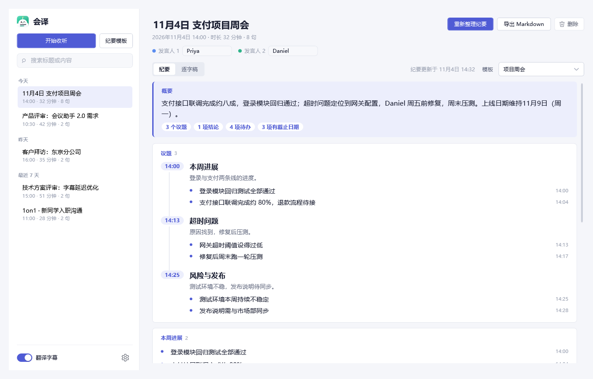
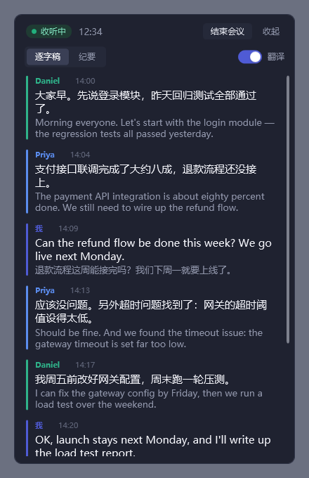
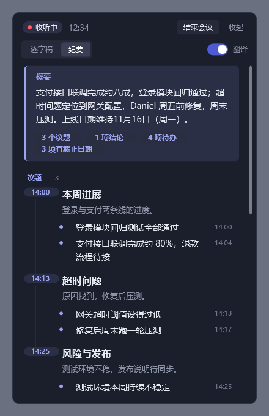
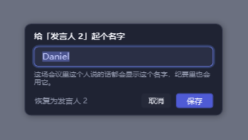
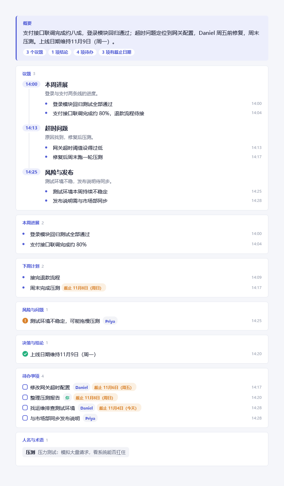
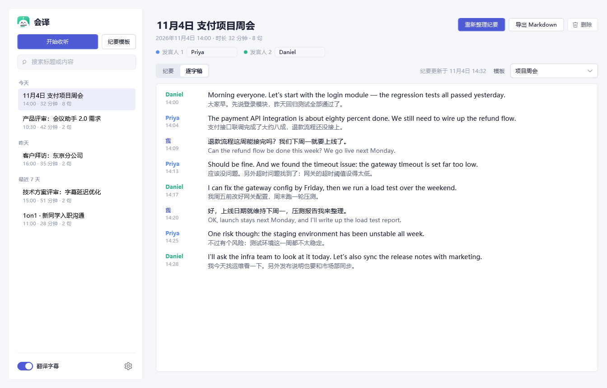
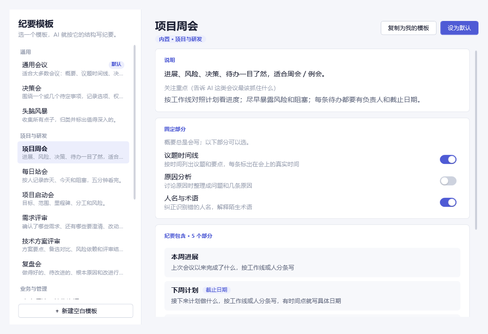
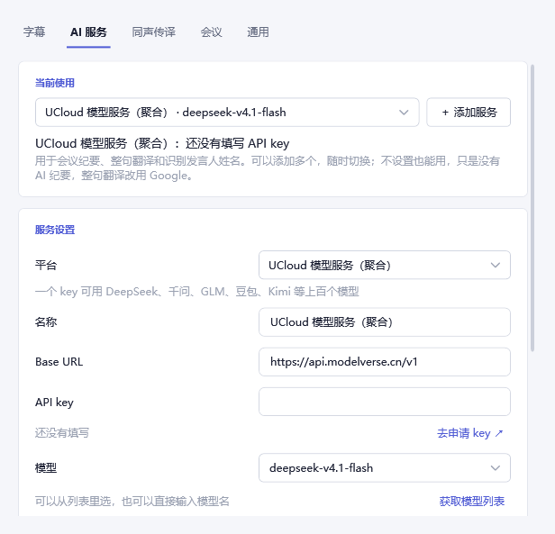
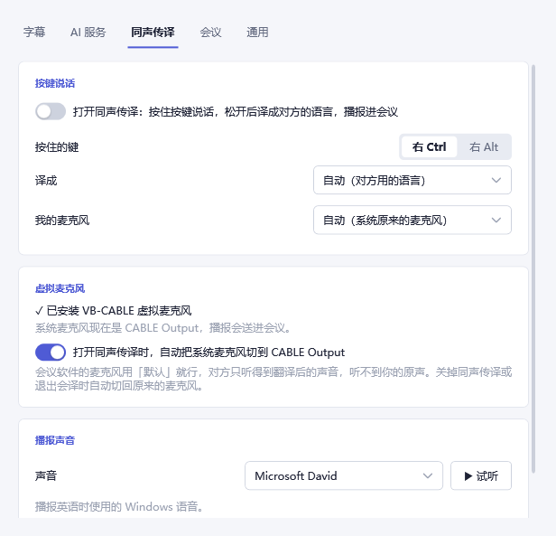

<p align="center">
  
</p>

<h1 align="center">会译 HuiYi</h1>

<p align="center">
  <b>Windows 上的 AI 会议助手：听得懂、记得住、说得出。</b><br>
  开会时它在旁边听：实时字幕和翻译、分清谁在说话、自动写纪要和待办，<br>
  还能把你说的中文实时译成对方的语言，说进会议里。
</p>

<p align="center">
  <a href="https://github.com/LingyiChen-AI/huiyi/releases/latest/download/HuiYi-Setup.exe"><b>⬇ 下载 Windows 安装包</b></a>
  &nbsp;·&nbsp;
  <a href="https://github.com/LingyiChen-AI/huiyi/releases">所有版本</a>
  &nbsp;·&nbsp;
  Windows 10 / 11（x64）· 免费开源
</p>

<p align="center">
  
</p>

## 它是做什么的

开跨语言的会、听外语分享、或者只是不想边开会边记笔记的时候，打开会译就行。它不需要接进任何会议软件：**电脑里放出来的声音它都能听**，腾讯会议、飞书、钉钉、Zoom、Teams、网页会议、直播和视频都可以。

| | |
|---|---|
| 🎧 **实时字幕 + 翻译** | 对方一开口就出字幕，自动识别中、英、日、韩、粤语，翻成你的语言 |
| 👥 **分清谁在说话** | 按声音把每个人分开（发言人 1、2…），可以改成真名，AI 也会从对话里猜名字 |
| 📝 **AI 会议纪要** | 边开会边整理：议题时间线、结论、待办（带负责人和截止日期），会后再按整场写一遍 |
| 🧩 **纪要模板** | 周会、站会、需求评审、客户拜访、面试、复盘……15 个内置模板，也能自己做 |
| 🗣️ **同声传译** | 按住右 Ctrl 说中文，松开后译成对方的语言，用语音说进会议 |
| 🔒 **隐私** | 语音识别、分辨说话人都在你的电脑上完成，录音不上传 |

## 看看它的样子

### 开会时：实时面板

开始收听后，屏幕边上会出现一个深色小面板：上面是逐字稿，原文和译文对照，每句标出是谁说的、几点说的；切到「纪要」，能看到 AI 正在整理的要点。**点发言人的名字就能改名**，这场会里这个人的话都会换成新名字。面板不会抢走焦点，**共享屏幕时对方看不到它**。

<p align="center">
  
  &nbsp;&nbsp;
  
</p>

<p align="center">
  
</p>

不想要面板的话，也可以换成屏幕底部的悬浮字幕：

<p align="center">
  
</p>

### 开完会：纪要和逐字稿

每场会议自动存一份记录，按日期分组、可以搜索。纪要里的时间都是**真实时间**：议题标会上的钟点，「周五前」「下周一」会换算成具体日期；待办事项带负责人和截止日期，可以一键导出 Markdown。

<p align="center">
  
</p>

逐字稿是双语对照的。外国同事说英文，你说中文，都能看懂：

<p align="center">
  
</p>

### 纪要模板中心

不同的会关心的东西不一样：周会看进展和风险，评审会看结论和待澄清问题，客户拜访看需求和承诺。选一个模板，AI 就按它的结构写；也可以复制一份，改成你们团队自己的格式。

<p align="center">
  
</p>

### 用你自己的大模型

纪要和整句翻译需要一个大模型。选平台、填 API key 就能用，Base URL 会自动填好，模型列表一键获取：DeepSeek、阿里云百炼（通义千问）、火山方舟（豆包）、蚂蚁百灵、Kimi、智谱、MiniMax、腾讯混元、百度千帆、硅基流动、UCloud、OpenAI、OpenRouter、本地 Ollama，或者任何兼容 OpenAI 接口的服务。不接大模型也能用：字幕、翻译、会议记录都照常工作，只是没有 AI 纪要。

<p align="center">
  
</p>

### 同声传译：让对方听懂你

按住右 Ctrl 说中文，松开后会译把它译成对方的语言，用语音通过虚拟麦克风说进会议，对方在会议软件里直接就能听到。虚拟麦克风可以在设置里一键安装，打开同声传译时会自动切换系统麦克风，关掉时再切回来。没翻译成功的话，这句绝不会说出去。

<p align="center">
  
</p>

## 安装和上手

1. 下载 [**HuiYi-Setup.exe**](https://github.com/LingyiChen-AI/huiyi/releases/latest/download/HuiYi-Setup.exe)，双击安装，可以自己选安装位置。不需要管理员权限，也不用另装 .NET。
2. 第一次打开会下载约 260 MB 的本机识别模型，下载完会自动校验。
3. 在会议里点任务栏右下角的会译图标，或者主界面的「开始收听」，字幕就出来了。
4. 想要 AI 纪要：在「设置 › AI 服务」里选一个平台，填上 API key。
5. 想要同声传译：在「设置 › 同声传译」里一键安装虚拟麦克风，然后打开开关。

会译会自己检查新版本：每 6 小时去 GitHub 看一次，下载好后提醒你；也可以在「设置 › 通用」里点「检查更新」，一键更新并重启。

> 也有免安装版 `HuiYi-<版本>-win-x64.zip`，解压就能用，但它不会自动更新。

## 隐私：什么会离开你的电脑

| 内容 | 去哪里 |
|---|---|
| 会议声音、录音 | **不离开电脑**。识别和分辨说话人都在本机完成 |
| 识别出的文字 | 打开翻译时发给翻译服务；接了大模型时发给你自己选的大模型，用来写纪要 |
| 同声传译时你说的话 | 先在本机识别成文字，再把文字送去翻译；用蚂蚁百灵时，译文会发给它合成语音 |
| API key | 只存在本机，用 Windows 加密保护，只有你的 Windows 账号能读取 |

## 数据放在哪

| 内容 | 位置 |
|---|---|
| 设置、会议记录（`Sessions\<id>\session.json`，格式与 Cicada 相同） | `%APPDATA%\HuiYi` |
| 各 AI 服务的 API key（每个服务一个文件，DPAPI 加密，只有当前 Windows 用户能解开） | `%APPDATA%\HuiYi\keys\` |
| 识别模型、调试日志（日志里没有对话内容和 key） | `%LOCALAPPDATA%\HuiYi` |

## 开发

需要 .NET 8 SDK。README 里的截图用演示数据生成：`HuiYi.exe --snapshot <目录> --demo`。

```powershell
dotnet build HuiYi.sln
dotnet test tests/HuiYi.Tests                      # 单测（含从 Cicada 移植的用例）
dotnet run --project src/HuiYi -- --show main      # 运行；--listen 启动即收听，--show main|settings|setup
                                                        # --feed <音频> 用文件代替系统声音；--snapshot <目录> 把各窗口渲染成 PNG
powershell -File scripts/package.ps1                    # 本地打包：artifacts\HuiYi-Setup.exe 安装向导 + 免安装 zip
powershell -File scripts/release.ps1 0.2.0              # 发版：改版本号、测试、打 tag 推送；GitHub Actions 打包并发布 Release
```

不带界面检查引擎：`tools/HuiYi.Cli`

```powershell
huiyi-cli models                        # 下载 / 校验模型
huiyi-cli transcribe <音频>             # 整段识别一次
huiyi-cli listen <音频> [目标语言]       # 在文件上跑完整的听写 + 翻译链路
huiyi-cli loopback <音频> [目标语言]     # 在扬声器上播放，同时采集系统声音识别（真实路径）
huiyi-cli translate <文本> <源> <目标>
huiyi-cli dialog <输出.wav>             # 用两个 Windows 语音合成一段两人对话（测发言人区分）
huiyi-cli voices | say <文本> <语言> | micusers
```

目录：

```
src/HuiYi.Core   引擎，不含界面：采集、识别、发言人区分、翻译、AI 服务（OpenAI 兼容）、纪要、会议记录、同声传译
src/HuiYi        WPF 界面：托盘、实时面板、悬浮字幕、会议记录、设置、首次引导向导
tests/                单测
tools/                命令行检查工具
scripts/package.ps1   打包
```

## 致谢与许可

Apache-2.0，见 `LICENSE`。部分处理逻辑（大模型调用约定、纪要提示词、断句合并、会议结束判断、发言人聚类规则等）移植自开源 macOS 应用 [Cicada](https://github.com/wquguru/cicada)（Apache-2.0），界面与产品形态为本项目自行设计，与该项目无隶属关系。移植内容和第三方组件的完整清单见 `NOTICE`。
